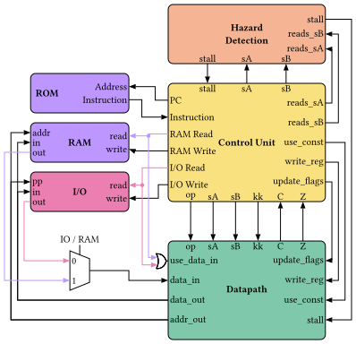

# CPU Architecture

Note: This repository is a university assignment. The complete assignment specification is in `docs/assignment.pdf`.
It is an 8-bit PicoBlaze-style processor written in VHDL, with a 2-stage pipeline and a compact instruction set modeled after the PicoBlaze/KCPSM family.

## Architecture



**Pipeline:** 2 stages -- Fetch/Decode and Execute/Writeback.
IO and memory control signals are delayed one cycle so they align with execute-stage data.

### Key features

- **16 general-purpose registers** (s0--sF), 8 bits each
- **18-bit instruction word** -- 6-bit opcode, 4-bit register address, 8-bit immediate/source
- **12-bit program counter** -- 4096-address instruction space
- **RAW hazard detection** -- combinational comparator stalls the pipeline when the execute stage writes a register that the decode stage needs to read
- **No delay slot** -- fetch and decode share a stage, so a taken jump loads the target into the PC and the next instruction is the target; the flush only turns the jump itself into an execute-stage bubble
- **IO unit** -- 256 input + 256 output ports, directly addressed by INPUT/OUTPUT instructions
- **Scratchpad RAM** -- 256 x 8-bit, synchronous write, asynchronous read (STORE/FETCH instructions)
- **ALU operations** -- ADD, ADDCY, SUB, SUBCY, AND, OR, XOR, TEST, TESTCY, shifts (SL0/SL1/SLA/SLX, SR0/SR1/SRA/SRX), rotates (RL/RR), COMPARE, COMPARECY, LOAD

## Project structure

```
assembler/
├── src/                       C# PicoBlaze-style assembler
├── lib/                       Shared assembler libraries
└── tests/                     Assembler test suite

src/
├── cpu.vhd                    Top-level CPU
├── types.vhd                  Core types (ro2_word, ro2_address, ...)
├── pkg/io_types_pkg.vhd       IO port array type
├── ControlUnit/               Instruction decoder, program counter, branch logic, control_unit wrapper
├── DataPath/                  ALU, register file, datapath pipeline
├── HazardDetection/           RAW hazard detector
├── IO_Unit/                   256-port IO bridge
└── MemoryUnit/                Instruction ROM + scratchpad RAM

sim/
├── cpu_tb.vhd                 Fibonacci integration test
├── cpu_instruction_tb.vhd     Per-instruction coverage (NOP, TEST, JC, JZ, INPUT, OUTPUT, STORE, FETCH)
├── cpu_pipeline_tb.vhd        Back-to-back stalls, stall+branch, reset recovery
├── cpu_stall_tb.vhd           Far jump + real RAW hazard
├── cpu_addcy_zero_tb.vhd      ADDCY zero flag chaining (z_i=1 vs z_i=0)
├── cpu_flush_tb.vhd           No-delay-slot verification
├── cpu_stress_tb.vhd          Cold start, Fibonacci, reset mid-execution, input noise
├── cpu_wrapper_tb.vhd         Minimal waveform-analysis wrapper
├── ControlUnit/               Unit tests for instruction decoder, program counter, branch logic, control_unit
├── DataPath/                  ALU, regfile, datapath, datapath flush tests
├── HazardDetection/           Hazard detector edge cases
├── IO_Unit/                   IO read/write sweep, isolation, boundary, simultaneous access
└── MemoryUnit/                Scratchpad RAM read/write, write protection, debug port

docs/                          Typst documentation + architecture diagrams
├── assignment.pdf             Full assignment specification
├── documentation.pdf          Compiled documentation
└── typst/                     Typst sources for the documentation

tests/                         System test (C#)
```

## Documentation

Full documentation in `docs/`, including the compiled PDF (`docs/documentation.pdf`), Typst sources in `docs/typst/`, and ISA/reference material in `docs/syntax/`. An architecture diagram is stored in `docs/architecture.drawio`.

## Assembler

The assembler is in `assembler/` and provides a PicoBlaze-style toolchain for assembling programs for this CPU. See `assembler/README.md` for usage and build instructions.
